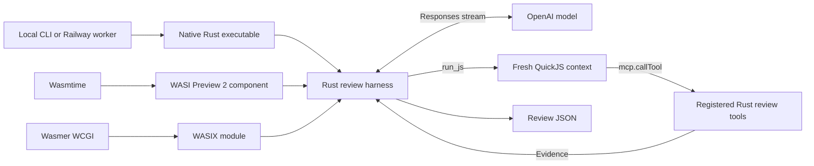
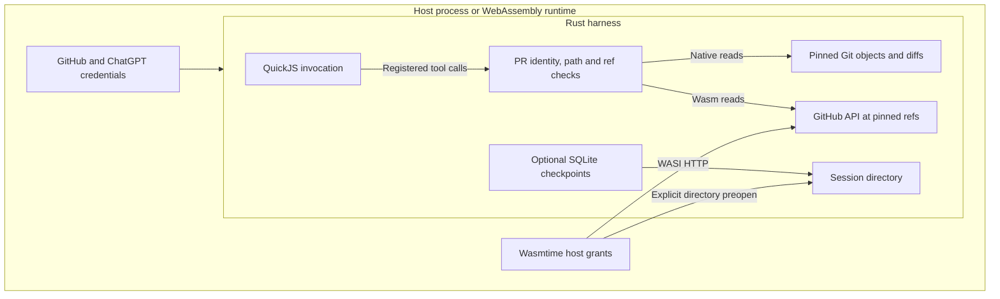

# Wrev

Wrev reviews GitHub pull requests against pinned commits. Run it locally to
get structured findings, or apply the `wrev` label to run it through the
Railway worker. Wrev uses a Rust review harness with embedded QuickJS and
authenticates model requests through Sign in with ChatGPT.

## Run locally

You’ll need Git and a GitHub token with read access to **Contents** and **Pull
requests** for the repository. An unpublished fork commit must also be
accessible to the credential.

```sh
nix-shell -p cargo rustc cmake pkg-config --run 'cargo build --locked --bin wrev'
./target/debug/wrev login
./target/debug/wrev models
```

Set `WREV_GITHUB_TOKEN` through your secret manager. Choose a slug from
`wrev models` and run the review.

```sh
OPENAI_MODEL='your-model-slug' ./target/debug/wrev review OWNER/REPO 123
```

The native CLI fetches the base and head into a temporary bare Git repository
and returns JSON on stdout. The `reviewbench CHECKOUT PR_JSON` command uses the
same snapshot reviewer with a supplied checkout. Build with
`--features sqlite-backend` and set `WREV_SESSION_DIR` to save checkpoints.
See [build instructions](BUILD.md) and [checkpoint recovery](docs/durability.md).

## Architecture

### Runtime and harness

The host runs the Rust harness. The model calls `run_js` to inspect evidence
through Rust tools registered for the current PR. QuickJS executes that
JavaScript in a fresh context for each call.



### Filesystem and security boundaries



- **Native filesystem.** Git objects and diffs are read as data. Wrev does
  not run code from the PR. The Railway worker stores queue data, encrypted
  credentials, and session checkpoints on its mounted volume.
- **Wasmtime filesystem.** The component reads PR files through the GitHub
  API. To persist checkpoints, the host preopens a session directory and
  passes its guest path as `WREV_SESSION_DIR`. WASI HTTP supplies network access
  to the Rust harness.
- **QuickJS.** Review scripts get the registered tool bridge and console
  output, with execution time, memory, stack, source, and output limits.
  GitHub and model requests are made by the Rust harness. Review tools check
  the permitted repository and commit before reading file content.
- **Search.** `rg` uses ripgrep's Rust libraries to search tracked text in
  the pinned head (default) or base. Omit `paths` to search the repository,
  or pass a list of repository-relative files. Repository-wide search
  enumerates regular tracked files. It never reads the host worktree
  or runs the ripgrep CLI.
  Match output and scan work are bounded to fit an agent call. Results say
  when scanning stops early and report skipped files; GitHub's Contents API
  can skip large files it cannot return inline.

  ```js
  const { structuredContent } = await mcp.callTool("rust", "rg", {
    pattern: "todo|fixme",
    ignore_case: true
  });
  console.log(JSON.stringify(structuredContent));
  ```

- **Webhook.** Verify the GitHub signature and scope incoming events to the
  configured repositories or owner. Railway uses separate credentials for
  reading PRs and writing comments or removing the trigger label.

## Listen for the label

The [Railway worker](https://github.com/r33drichards/webhook/blob/master/docs/Railway-wrev.md)
queues signed GitHub events on its own service. Applying `wrev` posts a start
comment when commenting is configured. Wrev updates the same comment with the
findings and removes the trigger label after a successful review. Removing the
label during a review cancels it. Operators can inspect stored results at
`GET /admin/reviews`.

The Wasmer WCGI listener handles `POST /github/webhook` inline. Configure
`WREV_REPOSITORIES` and `WREV_WEBHOOK_SECRET` and use `GET /health` to check
configuration. Successful matching deliveries return HTTP 204 and emit review
JSON to stderr. GitHub expects a webhook response within 10 seconds, which is
shorter than some reviews. A redelivery can run the review again. The Wasmtime
component can also be invoked by a separate webhook server. See
[Wasm build and deployment instructions](BUILD.md).

## Production releases

A push to `wrev/main` runs one pin-update job at a time. It opens or updates a
worker PR with the latest merged Wrev SHA. Merging the worker PR triggers
Railway to build from `webhook/master`. The worker Dockerfile pin controls the
reviewer version. The Wrev repository's `WREV_WORKER_TOKEN` Actions secret
needs **Contents** and **Pull requests** write access on the worker repo.

## ReviewBench results

Wrev and the Codex CLI each reviewed the same 219 frozen pull requests from the
[ReviewBench full corpus](https://github.com/review-bench/ReviewBench/blob/082f65f6746c39b6ac25b0a62c1b0d5131a3803a/corpus/manifest.json)
with GPT-6 Luna (`gpt-6-luna`). The
[ReviewBench offline judge](https://github.com/review-bench/ReviewBench/blob/082f65f6746c39b6ac25b0a62c1b0d5131a3803a/docs/OFFLINE_EVAL.md)
used GPT-6.1 Terra (`gpt-6.1-terra`) to match and classify findings.
These are micro-averaged results from one local pass per reviewer using a
development version of Wrev's local benchmark adapter. Both reviewers
completed all 219 pull requests.

| Metric | Wrev | Codex CLI |
| --- | ---: | ---: |
| Grounded precision | 79.7% | **83.2%** |
| Grounded recall | 2.6% | **4.7%** |
| Augmented precision | 62.5% | **70.8%** |
| Augmented recall | 3.4% | **6.1%** |
| Findings submitted | 128 | **209** |
| False positives (% of submitted findings) | 48 (37.5%) | **61 (29.2%)** |
| Novel true positives | 21 | **39** |

## Configuration

Set `OPENAI_MODEL` and `WREV_GITHUB_TOKEN` for live reviews. Noninteractive
runtimes can receive a Sign in with ChatGPT access token through
`CHATGPT_ACCESS_TOKEN`. Timeouts and byte limits must be positive integers.

| Variable | Default | Scope |
| --- | ---: | --- |
| `WREV_MODEL_TIMEOUT_SECS` | 180 | One model or model-catalog HTTP request |
| `WREV_GITHUB_TIMEOUT_SECS` | 20 | One GitHub API request |
| `WREV_SCRIPT_TIMEOUT_SECS` | 120 | One QuickJS invocation, including tool calls |
| `WREV_SCRIPT_CODE_BYTES` | 65536 | JavaScript source per invocation |
| `WREV_SCRIPT_OUTPUT_BYTES` | 65536 | Console output per invocation |
| `WREV_SCRIPT_MEMORY_BYTES` | 33554432 | QuickJS heap limit |
| `WREV_SCRIPT_STACK_BYTES` | 262144 | QuickJS stack limit |
| `WREV_LABEL` | `wrev` | PR label that triggers a review |
| `WREV_WEBHOOK_BODY_BYTES` | 1048576 | Maximum webhook request body |
| `WREV_AUTH_TIMEOUT_SECS` | 30 | One sign-in or credential refresh HTTP request |
| `WREV_OAUTH_CALLBACK_TIMEOUT_SECS` | 300 | Time to complete the local browser sign-in |
| `WREV_OAUTH_READ_TIMEOUT_SECS` | 2 | Reading the local sign-in callback |

### Hosted ChatGPT credentials

For the built-in Wasmer listener, enable `mysql-backend`, apply
[migration 002](migrations/002_chatgpt_credentials.sql), and configure
[verified MySQL TLS](MYSQL_BACKEND.md). Set independent
`WREV_CREDENTIAL_ADMIN_TOKEN` (at least 32 random ASCII characters) and
`WREV_CREDENTIAL_ENCRYPTION_KEY` (32 random bytes as 64 hex characters). Keep
the encryption key consistent across replicas and deployments.

Send an authenticated HTTPS `PUT /admin/chatgpt-credentials` with
`access_token` and `expires_at` in Unix seconds. Include `refresh_token` and
the issued `client_id` for renewal. The stored grant takes precedence over
`CHATGPT_ACCESS_TOKEN` for this listener. Use a dedicated grant for the
deployment to avoid independent refreshes. For Railway’s separate SQLite
store, see the [worker runbook](https://github.com/r33drichards/webhook/blob/master/docs/Railway-wrev.md).
